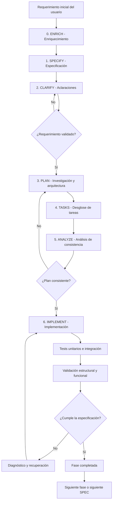
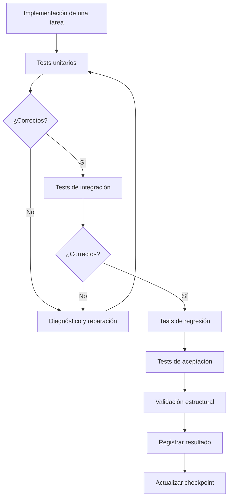

# INFORME TÉCNICO INTEGRAL
# Herramienta Visual de Desarrollo Guiado por Especificaciones (SDD)

**Identificador:** SDD Visual Development Assistant
**Fecha:** 9 de noviembre de 2026
**Estado:** SPEC v0.1 adoptada — alcance del nuevo producto (se empieza de 0)
**Tipo de producto:** Herramienta de desarrollo integrada en IDE y CLI
**Referencia funcional:** GitHub Spec Kit, OpenSpec y ecosistema de desarrollo asistido por IA.

---

# PARTE I. VISIÓN GENERAL DEL PRODUCTO

## 1. Objetivo principal

Construir una herramienta de Desarrollo Guiado por Especificaciones (Specification-Driven Development, SDD) que mejore la experiencia de programación mediante inteligencia artificial.

La herramienta no debe ser un framework de programación ni un sustituto del IDE.

Debe funcionar como una herramienta de orquestación, asistencia y control del proceso de desarrollo, integrada en los entornos de programación existentes.

Su objetivo es que los agentes de IA produzcan mejores resultados, mantengan la coherencia del proyecto y sigan las especificaciones acordadas.

La herramienta debe permitir:

- Crear y gestionar especificaciones.
- Transformar ideas iniciales en requerimientos estructurados.
- Investigar y comprender proyectos existentes.
- Planificar cambios antes de implementarlos.
- Dividir funcionalidades en tareas verificables.
- Acompañar la implementación de código.
- Ejecutar pruebas durante el desarrollo.
- Detectar desviaciones respecto de las especificaciones.
- Recuperar el estado del trabajo ante interrupciones.
- Mantener la continuidad entre sesiones.
- Mostrar visualmente qué está haciendo la IA y en qué fase se encuentra.
- Permitir que el usuario controle el proceso sin tener que intervenir constantemente en cuestiones técnicas.

**Principio fundamental:** mejorar la experiencia de desarrollo con IA, no convertir cada operación en un procedimiento burocrático de autorización.

## 2. Filosofía de funcionamiento

La herramienta debe equilibrar tres dimensiones:

1. **Libertad de desarrollo:** permitir que la IA resuelva problemas y proponga soluciones técnicas.
2. **Coherencia:** evitar que implemente funcionalidades no solicitadas, contradiga decisiones o se aleje del objetivo.
3. **Continuidad:** conservar el contexto y el progreso para que el agente pueda retomar el trabajo sin empezar de cero.

No se busca bloquear todo lo que haga la IA.

Se busca que trabaje con mayor precisión, conocimiento del proyecto y capacidad de recuperación.

## 3. Problemas que debe resolver

### 3.1. Desviación de especificaciones (Feature Creep)

La IA puede agregar:

- Funcionalidades no solicitadas.
- Nuevas dependencias innecesarias.
- Refactorizaciones ajenas al objetivo.
- Cambios cosméticos.
- Modificaciones de arquitectura no aprobadas.
- Sistemas adicionales que no forman parte del requerimiento.

La herramienta debe detectar y prevenir esas desviaciones.

### 3.2. Pérdida de contexto

Durante sesiones prolongadas, los agentes pueden olvidar:

- Qué funcionalidad estaban implementando.
- Qué tareas ya terminaron.
- Qué archivos modificaron.
- Qué decisiones tomó el usuario.
- Qué problemas encontraron.
- Qué soluciones ya intentaron.
- Cuál es el siguiente paso.

La herramienta debe mantener un estado persistente y recuperable.

### 3.3. Bucles de reparación

Cuando una prueba falla, la IA puede acumular parches, repetir soluciones fallidas o modificar componentes que funcionaban correctamente.

La herramienta debe detectar la repetición de errores, conservar evidencia, recuperar un estado seguro y exigir una estrategia diferente.

### 3.4. Falta de integración entre planificación e implementación

La especificación, el plan, las tareas y las pruebas deben permanecer relacionados.

No deben convertirse en documentos independientes que el agente deja de consultar una vez que comienza a programar.

### 3.5. Falta de visibilidad

El usuario debe saber:

- En qué fase está.
- Qué está procesando la IA.
- Qué documentos se generaron.
- Qué tareas se completaron.
- Qué pruebas se ejecutaron.
- Qué errores aparecieron.
- Qué decisiones necesitan intervención humana.
- Qué acción puede realizar a continuación.

---

# PARTE II. ARQUITECTURA GENERAL DEL PIPELINE SDD

## 4. Ciclo de vida completo

El pipeline se compone de siete fases principales, precedidas por un enriquecimiento opcional del requerimiento inicial.



El flujo debe ser administrado por una máquina de estados persistente.

Las fases no deben depender exclusivamente de la memoria del chat.

Cada fase debe guardar su estado, sus resultados y sus referencias a los artefactos generados.

## 5. Fase 0: `/enrich` — Enriquecimiento del requerimiento inicial

### 5.1. Objetivo

Transformar una instrucción inicial breve en una descripción de requerimientos más completa y organizada.

Ejemplo:

```text
/enrich Quiero un dashboard para gestionar un kiosco.
```

El enriquecimiento trabaja exclusivamente sobre esa instrucción inicial y el contexto que el usuario haya autorizado.

No debe comenzar a programar ni investigar indiscriminadamente todo el repositorio.

### 5.2. Análisis semántico

El motor debe identificar:

- Objetivo principal.
- Dominio del problema.
- Entidades involucradas.
- Funcionalidades mencionadas.
- Relaciones entre entidades.
- Requerimientos explícitos.
- Información faltante.
- Posibles reglas de negocio.
- Restricciones iniciales.
- Elementos que deben quedar fuera del alcance.

### 5.3. Clasificación de información

Cada elemento generado debe quedar identificado según su procedencia:

| Clasificación | Significado |
|---|---|
| Explícito | El usuario lo pidió directamente. |
| Inferido | La IA considera que puede ser necesario. |
| Sugerido | Es una posibilidad que puede mejorar el producto. |
| Desconocido | Necesita información adicional. |
| Excluido | No forma parte del alcance actual. |

Las inferencias no deben convertirse automáticamente en requerimientos aprobados.

### 5.4. Ejemplo de enriquecimiento

Entrada:

```text
Quiero un dashboard para gestionar un kiosco.
```

Resultado estructurado:

**Objetivo:** gestionar las operaciones de un kiosco mediante un dashboard.

**Entidades potenciales:**
- Productos.
- Inventario.
- Ventas.
- Movimientos de stock.
- Caja.

**Posibles funcionalidades:**
- Visualización de productos.
- Consulta de existencias.
- Registro de ventas.
- Actualización de inventario.
- Búsqueda de productos.

**Inferencias pendientes de aprobación:**
- Alertas de stock mínimo.
- Lectura de códigos de barras.
- Cierre de caja.
- Reportes de ventas.

**Fuera de alcance inicial:**
- Gestión de franquicias.
- Múltiples sucursales.
- Integración con pasarelas de pago.
- Sistemas de crédito para clientes.

### 5.5. Validación del enriquecimiento

La salida debe presentarse al usuario antes de continuar.

El usuario puede:

- Aceptar.
- Editar.
- Eliminar funcionalidades.
- Incorporar nuevos requerimientos.
- Rechazar inferencias.
- Solicitar otro enriquecimiento.

Una vez validado, el resultado se utiliza como entrada de `/specify`.

### 5.6. Stack y restricciones

El enriquecedor debe respetar el stack existente si se conoce.

No debe inventar tecnologías, bases de datos o proveedores.

Si el stack es desconocido, debe identificarlo como pendiente de aclaración, en lugar de imponer una arquitectura.

---

## 6. Fase 1: `/specify` — Generación de especificaciones

### 6.1. Objetivo

Generar el documento técnico que define qué se debe desarrollar y cuáles son sus condiciones de aceptación.

El artefacto debe ser persistente y versionado.

### 6.2. Estructura recomendada

Cada SPEC debe contener:

1. Identificación y metadatos.
2. Contexto y propósito.
3. Problema que resuelve.
4. Requerimientos funcionales.
5. Requerimientos no funcionales.
6. Entidades y modelos de datos.
7. Reglas de negocio.
8. Comportamientos esperados.
9. Restricciones del entorno.
10. Dependencias conocidas.
11. Criterios de aceptación.
12. Casos de prueba.
13. Fuera de alcance.
14. Suposiciones pendientes.
15. Referencias y trazabilidad.

### 6.3. Metadatos

Ejemplo:

```yaml
---
spec_id: SPEC-001
spec_version: 1.0.0
status: draft
created_at: ""
updated_at: ""
approved_at: null
quality_gates:
  - clarification
  - testing
  - structural_validation
---
```

Los metadatos deben representar el estado real.

La IA no puede marcar una especificación como aprobada sin la validación humana correspondiente.

### 6.4. Atomicidad

Una SPEC debe representar una funcionalidad o conjunto coherente de requerimientos.

Si contiene demasiados flujos independientes, el sistema debe recomendar dividirla en varias especificaciones.

No debe fragmentar automáticamente un requerimiento si eso destruye relaciones funcionales importantes.

### 6.5. OUT OF SCOPE

La sección de exclusiones debe ser explícita.

Debe indicar qué funcionalidades no se implementarán dentro de esa especificación.

Las exclusiones también deben permanecer disponibles durante la implementación.

### 6.6. Versionado

Cuando se modifica una SPEC:

- Se conserva el historial.
- Se registra qué cambió.
- Se identifica el motivo.
- Se determina si afecta el plan.
- Se identifica qué tareas necesitan actualizarse.
- Se detectan pruebas que dejaron de representar los requerimientos.

Una modificación aprobada no debe borrar silenciosamente decisiones anteriores.

---

## 7. Fase 2: `/clarify` — Clarificación de requerimientos

### 7.1. Objetivo

Detectar ambigüedades antes de que se conviertan en decisiones de arquitectura o código.

### 7.2. Detección

El motor debe buscar:

- Requerimientos incompletos.
- Comportamientos no definidos.
- Tipos de datos ambiguos.
- Reglas de negocio contradictorias.
- Dependencias desconocidas.
- Casos límite no contemplados.
- Requerimientos funcionales incompatibles.
- Decisiones técnicas sin fundamento.

### 7.3. Interfaz interactiva

Cuando encuentre una ambigüedad, debe presentar preguntas contextualizadas.

Ejemplo:

**¿Cómo se debe almacenar el inventario?**

- Un archivo local.
- Una base de datos local.
- Una base de datos remota.
- Todavía no lo sé.

Las preguntas deben permitir respuestas parciales y explicaciones libres.

No debe generar formularios innecesarios cuando la información ya está definida.

### 7.4. Reglas

- No inventar respuestas.
- No resolver decisiones de negocio sin autorización.
- No repetir preguntas ya contestadas.
- Conservar las respuestas.
- Actualizar la SPEC.
- Registrar qué cambió como consecuencia de cada respuesta.

### 7.5. Quality Gate 1

La fase termina cuando los aspectos necesarios para continuar están suficientemente definidos.

No es necesario resolver absolutamente todos los detalles de implementación futura.

---

## 8. Fase 3: `/plan` — Investigación, arquitectura e impacto

### 8.1. Objetivo

Determinar cómo implementar la especificación dentro del proyecto existente.

Esta fase debe enriquecer técnicamente el requerimiento mediante información real del repositorio.

A diferencia de `/enrich`, aquí sí corresponde investigar el código existente.

### 8.2. Investigación del proyecto

El motor debe analizar:

- Estructura de carpetas.
- Lenguajes y tecnologías.
- Dependencias.
- Arquitectura existente.
- Componentes involucrados.
- Interfaces públicas.
- Modelos de datos.
- Sistemas de persistencia.
- Pruebas existentes.
- Convenciones de desarrollo.
- Posibles conflictos.

No debe realizar una exploración indiscriminada cuando puede limitarse a los componentes relacionados.

### 8.3. Context Split-Streaming

Se propone una estrategia de lectura selectiva.

**Archivos modificables:**
- Contexto completo de las partes necesarias.
- Funciones y clases que deben modificarse.
- Dependencias relevantes.

**Archivos de solo lectura:**
- Firmas de funciones.
- Clases.
- Interfaces.
- Tipos.
- Dependencias públicas.

Cuando sea útil, el motor puede generar representaciones estructurales o stubs para reducir el contexto.

La selección debe conservar suficiente información para no producir implementaciones incorrectas.

### 8.4. Fronteras de código

Cada plan debe identificar:

- Archivos que pueden modificarse.
- Archivos que deben permanecer intactos.
- Archivos que pueden crearse.
- Componentes que deben reutilizarse.
- Interfaces que deben conservarse.
- Dependencias que pueden modificarse.
- Elementos que requieren autorización adicional.

### 8.5. Plan técnico

Debe contener:

- Arquitectura propuesta.
- Dependencias.
- Componentes afectados.
- Orden de implementación.
- Estrategia de integración.
- Riesgos.
- Compatibilidad.
- Impacto sobre funciones existentes.
- Estrategia de pruebas.
- Criterios de validación.

### 8.6. Quality Gate 2

Se valida que el plan responda a la SPEC y al estado real del repositorio.

No debe introducir funcionalidades nuevas por conveniencia técnica.

Las alternativas técnicas pueden presentarse como sugerencias, diferenciadas de las decisiones aprobadas.

---

## 9. Fase 4: `/tasks` — Desglose de trabajo

### 9.1. Objetivo

Transformar el plan en unidades de trabajo pequeñas, secuenciales y comprobables.

### 9.2. Características

Cada tarea debe incluir:

- Identificador.
- Descripción.
- Objetivo.
- Archivos involucrados.
- Dependencias.
- Precondiciones.
- Resultado esperado.
- Criterio de aceptación.
- Pruebas asociadas.
- Estado.
- Intentos realizados.

### 9.3. Atomicidad de las tareas

Una tarea debe poder ejecutarse y verificarse de manera independiente siempre que sea posible.

No utilizar descripciones vagas como:

```text
Implementar inventario.
```

Preferir:

```text
TASK-001

Objetivo:
Implementar la inicialización del inventario.

Archivos:
src/systems/inventory.py

Resultado:
El sistema crea una estructura vacía cuando no existe
el archivo de persistencia.

Verificación:
La prueba de inicialización debe pasar.
```

### 9.4. Dependencias

Las tareas deben tener relaciones explícitas.

No se puede ejecutar una tarea si depende de otra que todavía no está disponible.

### 9.5. Quality Gate 3

Antes de implementar, el sistema comprueba:

- Que todas las tareas estén relacionadas con la SPEC.
- Que no haya tareas sin criterios de aceptación.
- Que las dependencias estén resueltas.
- Que los archivos objetivo estén identificados.
- Que las pruebas estén previstas.

---

## 10. Fase 5: `/analyze` — Análisis de consistencia

### 10.1. Objetivo

Comprobar que SPEC, plan y tareas no se contradigan.

### 10.2. Análisis

El motor debe identificar:

- Requerimientos sin tareas.
- Tareas sin requerimientos.
- Criterios de aceptación sin pruebas.
- Dependencias incompatibles.
- Modificaciones fuera de alcance.
- Archivos protegidos involucrados.
- Conflictos con arquitectura existente.
- Cambios de interfaz pública.
- Riesgos de regresión.

### 10.3. Resultado

El sistema genera un informe de consistencia.

Cada problema debe tener:

- Identificador.
- Severidad.
- Artefactos afectados.
- Evidencia.
- Explicación.
- Acción recomendada.

### 10.4. Quality Gate 4 de planificación

Solo se habilita la implementación cuando las inconsistencias críticas están resueltas.

Las advertencias menores pueden quedar registradas si no impiden ejecutar el trabajo.

---

# PARTE III. MOTOR DE IMPLEMENTACIÓN Y CONTROL

## 11. Fase 6: `/implement`

Esta es la fase central de ejecución.

Debe integrar el trabajo del agente de IA con el seguimiento de tareas, pruebas, validaciones y recuperación.

### 11.1. Spec Pinning

Antes de cada operación de escritura, el agente debe disponer de las restricciones relevantes:

- SPEC activa.
- Requerimiento asociado.
- Tarea activa.
- Criterios de aceptación.
- Archivos autorizados.
- Exclusiones.
- Interfaces protegidas.
- Decisiones aprobadas.

La información debe suministrarse mediante el mecanismo de contexto que permita el agente o IDE.

No se debe asumir que todas las plataformas permiten interceptar directamente las llamadas internas del modelo.

### 11.2. Control de cambios

El motor debe identificar qué cambios pertenecen a la tarea activa.

Cada cambio debe poder relacionarse con:

- Una tarea.
- Un requerimiento.
- Un criterio de aceptación.
- Un archivo autorizado.

Si la IA encuentra una mejora que no pertenece al alcance, puede registrarla como sugerencia, pero no implementarla silenciosamente.

### 11.3. Implementación incremental

El agente debe:

1. Leer el estado actual.
2. Recuperar la SPEC.
3. Identificar la tarea activa.
4. Revisar el contexto técnico necesario.
5. Implementar la modificación.
6. Ejecutar las pruebas pertinentes.
7. Analizar los resultados.
8. Validar el diff.
9. Registrar el resultado.
10. Actualizar el estado.

No debe avanzar a otra tarea sin completar o registrar explícitamente la situación de la actual.

---

## 12. Spec Pinning y prevención de código fuera de alcance

El objetivo es mantener las restricciones relevantes presentes durante toda la implementación.

### Mecanismos

- Relectura de la SPEC.
- Inyección de restricciones relevantes.
- Vinculación de cada cambio con una tarea.
- Comparación de archivos modificados.
- Detección de nuevas funciones y clases.
- Comparación de firmas públicas.
- Detección de modificaciones en archivos protegidos.
- Validación de criterios de aceptación.

### Tratamiento de desviaciones

Se deben diferenciar tres situaciones:

**A. Cambio requerido:** está relacionado con la tarea y cumple la especificación.

**B. Cambio técnico necesario:** no estaba detallado, pero es indispensable para cumplir un requerimiento aprobado. Debe documentarse y justificarse.

**C. Cambio ajeno:** agrega una funcionalidad no solicitada. Debe excluirse de la implementación actual y registrarse como sugerencia.

No todo cambio estructural nuevo es automáticamente incorrecto. Una implementación puede necesitar nuevas funciones internas.

El criterio debe ser la trazabilidad y la compatibilidad, no una prohibición indiscriminada de agregar símbolos.

---

## 13. State Journaling — Persistencia del estado

### 13.1. Objetivo

Crear una memoria operativa persistente que permita recuperar el trabajo después de:

- Cierres inesperados.
- Caídas del IDE.
- Interrupciones de terminal.
- Reinicios.
- Agotamiento del contexto.
- Cambios de sesión.
- Fallos del agente.

### 13.2. Ubicación

Se propone:

```text
.specify/
├── memory/
├── current_task.json
└── execution_history.jsonl
```

### 13.3. Estado de ejecución

Ejemplo:

```json
{
  "current_spec": "SPEC-001",
  "current_phase": "implement",
  "total_tasks": 5,
  "last_successful_task_index": 2,
  "in_progress_task": {
    "id": "TASK-003",
    "index": 3,
    "description": "Implementar alerta de stock crítico",
    "target_files": [
      "src/components/Dashboard.jsx"
    ],
    "status": "in_progress"
  },
  "execution_state": {
    "consecutive_failures": 0,
    "forbidden_strategies": [],
    "last_checkpoint": "TASK-002-SUCCESS"
  }
}
```

### 13.4. Checkpoints semánticos

Cada tarea completada debe producir un checkpoint que contenga:

- SPEC activa.
- Fase.
- Tarea completada.
- Próxima tarea.
- Archivos modificados.
- Hashes relevantes.
- Pruebas ejecutadas.
- Resultados.
- Decisiones tomadas.
- Problemas pendientes.

### 13.5. Actualización segura

El estado debe actualizarse de manera atómica.

Debe evitar archivos JSON parcialmente escritos y registros inconsistentes.

Es recomendable utilizar:

- Escritura temporal.
- Renombrado atómico.
- Validación de esquema.
- Copias de recuperación.
- Historial de eventos.
- Identificadores únicos de ejecución.

### 13.6. Recuperación

Al reiniciar, el toolkit debe:

1. Detectar una ejecución interrumpida.
2. Leer el último estado persistido.
3. Validar la SPEC correspondiente.
4. Verificar el estado del repositorio.
5. Comparar los hashes registrados.
6. Comprobar qué cambios sobrevivieron.
7. Revisar las últimas pruebas.
8. Identificar la tarea pendiente.
9. Presentar al usuario un resumen de recuperación.
10. Reanudar desde un estado verificable.

No debe asumir que una tarea quedó completada simplemente porque el agente había informado que terminó.

---

## 14. Context Split-Streaming — Optimización del contexto

### Objetivo

Reducir el ruido que recibe el modelo y mejorar la precisión de sus modificaciones.

### Estrategia

El motor debe proporcionar información progresivamente.

En lugar de cargar indiscriminadamente todo el repositorio:

1. Identificar los componentes relacionados con la tarea.
2. Obtener las funciones y clases necesarias.
3. Obtener las interfaces de las dependencias.
4. Recuperar los requerimientos relevantes.
5. Incluir las restricciones aplicables.
6. Incorporar los resultados de pruebas pertinentes.

### Modos de contexto

- Contexto de requerimientos.
- Contexto de arquitectura.
- Contexto de implementación.
- Contexto de pruebas.
- Contexto de recuperación.

El contexto debe poder reconstruirse desde los artefactos persistentes.

### Ventajas esperadas

- Menor consumo de tokens.
- Menos información irrelevante.
- Mayor concentración en la tarea activa.
- Menor riesgo de modificaciones colaterales.
- Mejor continuidad entre sesiones.

---

## 15. Context Flush — Recuperación ante degradación de contexto

Se propone incorporar un mecanismo de renovación del contexto cuando la conversación acumule demasiada información irrelevante.

El umbral de 30.000 tokens apareció como ejemplo en el diseño inicial, no como valor universal.

Debe ser configurable y adaptarse al modelo y al IDE.

### Procedimiento

1. Detectar saturación o degradación.
2. Guardar un checkpoint.
3. Registrar el trabajo pendiente.
4. Resumir las decisiones importantes.
5. Conservar errores y estrategias fallidas relevantes.
6. Iniciar una sesión nueva cuando la integración lo permita.
7. Inyectar la SPEC, el plan y la tarea activa.
8. Verificar el estado antes de continuar.

La renovación del contexto no debe borrar información durable ni asumir que el toolkit puede reiniciar cualquier chat de cualquier IDE.

---

## 16. Snapshot Rollback — Recuperación ante fallos

### Problema

La IA puede acumular correcciones sobre una implementación defectuosa.

### Mecanismo propuesto

Mantener snapshots de los cambios correspondientes a cada tarea.

Cuando se detecten dos fallos consecutivos con la misma firma de error:

1. Detener los intentos automáticos.
2. Capturar la excepción.
3. Comparar los errores.
4. Registrar la estrategia utilizada.
5. Recuperar el último estado seguro.
6. Incorporar la estrategia fallida al registro.
7. Exigir una solución diferente.
8. Reiniciar la tarea desde el punto verificado.

### Registro de estrategias fallidas

```json
{
  "forbidden_strategies": [
    {
      "task_id": "TASK-003",
      "error_signature": "TypeError: invalid stock value",
      "strategy": "Direct float conversion",
      "attempts": 2,
      "reason": "La solución produjo el mismo error"
    }
  ]
}
```

El sistema debe evitar repetir soluciones que ya fracasaron.

El rollback debe ser selectivo y seguro. No debe ejecutar `git checkout` indiscriminadamente ni eliminar modificaciones preexistentes del usuario.

Se recomienda utilizar worktrees, snapshots o mecanismos de aislamiento para proteger el trabajo ajeno a la tarea.

---

## 17. Post-Diff Structural Check — Validación AST

### Objetivo

Comparar el estado del código antes y después de la implementación.

### 17.1. Análisis estructural

El motor debe analizar:

- Nuevas funciones.
- Nuevas clases.
- Variables globales.
- Cambios de firmas.
- Tipos de retorno.
- Imports.
- Dependencias.
- Modificaciones de interfaces públicas.
- Archivos afectados.
- Símbolos eliminados.

### 17.2. Comparación

```text
          CÓDIGO ORIGINAL
                 |
                 v
             AST BASE
                 |
                 |
       +---------+---------+
       |                   |
       v                   v
  CÓDIGO NUEVO        SPEC + TASKS
       |                   |
       v                   |
     AST FINAL             |
       |                   |
       +---------+---------+
                 |
                 v
        COMPARADOR ESTRUCTURAL
                 |
                 v
       VALIDACIÓN DE CAMBIOS
                 |
         +-------+-------+
         |               |
         v               v
      ACEPTADO        DESVIACIÓN
         |               |
         v               v
    Continuar       Rechazar o revisar
```

### 17.3. Validación semántica

Un AST por sí solo no puede determinar si una función nueva está autorizada por una especificación escrita en lenguaje natural.

Por eso se necesita una capa adicional de trazabilidad semántica.

El sistema debe comparar:

- Tarea activa.
- Símbolos afectados.
- Archivos autorizados.
- Objetivo funcional.
- Contratos de interfaces.
- Evidencias de pruebas.

### 17.4. Tratamiento de resultados

**Aceptado:** los cambios son compatibles con la tarea.

**Advertencia:** existen cambios adicionales justificables que necesitan revisión.

**Rechazado:** se detectó una modificación no autorizada o incompatible.

La restauración debe afectar exclusivamente los cambios controlados por la ejecución actual.

---

# PARTE IV. SISTEMA DE TESTING INTEGRADO

## 18. Testing Harness

Las pruebas deben formar parte del flujo natural de trabajo.

No deben quedar relegadas a una fase opcional al finalizar todo el proyecto.

El toolkit debe solicitar y ejecutar las pruebas en el momento apropiado.

### 18.1. Tipos de pruebas

**Pruebas unitarias**
- Funciones individuales.
- Clases.
- Validaciones.
- Cálculos.
- Casos límite.

**Pruebas de integración**
- Comunicación entre módulos.
- Interfaces.
- Bases de datos.
- Servicios.
- Dependencias.

**Pruebas generales**
- Flujos completos.
- Compatibilidad.
- Regresiones.
- Funcionamiento global.

**Pruebas estructurales**
- Interfaces públicas.
- Firmas.
- Dependencias.
- Contratos.
- Cambios AST.

**Pruebas de aceptación**
- Comportamientos definidos en la SPEC.
- Casos Given-When-Then.
- Cumplimiento de requerimientos.

### 18.2. Ciclo de testing



### 18.3. Protección de pruebas

La IA no debe modificar los tests para conseguir que el resultado sea verde.

Si una prueba está incorrecta o quedó desactualizada por un cambio aprobado de requerimientos, debe documentarse y justificarse su modificación.

La regla es impedir que el agente manipule los criterios de éxito para ocultar errores.

### 18.4. Resultados visibles

La interfaz debe mostrar:

- Total de pruebas.
- Pruebas aprobadas.
- Pruebas fallidas.
- Pruebas omitidas.
- Duración.
- Errores.
- Cobertura, cuando esté disponible.
- Comparación con ejecuciones anteriores.

### 18.5. Consolidación

Una tarea no se marca como terminada simplemente porque la IA terminó de escribir código.

Debe cumplir los criterios aplicables y conservar evidencia de las pruebas ejecutadas.

---

# PARTE V. INTERFAZ VISUAL E INTERACTIVA

## 19. Concepto de interfaz

La herramienta debe ofrecer una experiencia visual más clara y dinámica que una sucesión de comandos de terminal.

Debe mantener la simplicidad de utilización de Spec Kit, pero permitir observar el proceso completo.

La interfaz no debe convertirse en un IDE alternativo.

Debe complementar el IDE donde se programa.

## 20. Panel de estado general

El usuario debe visualizar:

- Proyecto activo.
- SPEC activa.
- Fase actual.
- Progreso general.
- Tarea actual.
- Última tarea completada.
- Tareas pendientes.
- Estado de pruebas.
- Errores.
- Próxima acción.

## 21. Árbol de estados (State Tree View)

Cada fase debe mostrarse como un nodo visual.

Estados sugeridos:

| Estado | Representación |
|---|---|
| Pendiente | Gris |
| En progreso | Azul |
| Completado | Verde |
| Requiere intervención | Amarillo |
| Fallido | Rojo |
| Recuperado | Indicador diferenciado |

El usuario debe poder consultar el historial de transiciones.

## 22. Identificación visual de fases

Cada fase debe tener identidad propia.

| Fase | Icono | Nombre |
|---|---|---|
| Enrich | 🌀 | Enriquecimiento |
| Specify | 📝 | Especificación |
| Clarify | 🔍 | Aclaraciones |
| Plan | 📐 | Arquitectura |
| Tasks | 💾 | Tareas |
| Analyze | 🛡️ | Análisis |
| Implement | ⚡ | Implementación |
| Testing | 🧪 | Pruebas |
| Recovery | ♻️ | Recuperación |

La identidad visual debe mantenerse tanto en la interfaz como en la terminal.

## 23. Consola de restricciones activa

Se propone un panel lateral que muestre las restricciones de la SPEC activa.

Debe presentar:

- Fuera de alcance.
- Archivos protegidos.
- Archivos modificables.
- Interfaces protegidas.
- Reglas de negocio.
- Restricciones técnicas.
- Decisiones aprobadas.

Durante la implementación puede indicar qué restricciones se están verificando.

## 24. Visual AST Diff

Cuando se complete una modificación, la herramienta debe mostrar:

- Archivos modificados.
- Funciones agregadas.
- Funciones eliminadas.
- Firmas modificadas.
- Variables modificadas.
- Cambios estructurales.
- Cambios fuera de alcance.
- Resultado de validación.

Se propone una vista comparativa de código y una vista estructural.

El usuario debe comprender por qué un cambio fue aceptado o rechazado.

## 25. Clarify interactivo

La interfaz debe poder transformarse en un sistema de preguntas dinámicas.

Puede presentar:

- Opciones múltiples.
- Campos de texto.
- Selecciones.
- Confirmaciones.
- Explicaciones contextuales.

Las respuestas deben actualizar los artefactos correspondientes.

## 26. Navegación mediante píldoras

Una de las características expresamente solicitadas es que al terminar cada fase exista una forma nativa y clara de continuar.

Ejemplo:

```text
🟢 FASE COMPLETADA: SPECIFY

La especificación SPEC-001 fue generada.

Estado:
✓ Objetivo definido
✓ Requerimientos registrados
✓ Fuera de alcance definido
✓ Artefacto guardado

¿Qué deseas hacer ahora?

[ /clarify ]  [ /plan ]  [ Revisar SPEC ]
```

En una interfaz compatible, estas opciones deben ser controles interactivos reales.

En la CLI deben existir comandos equivalentes.

No basta con mostrar botones decorativos que no ejecutan ninguna acción.

### Reglas de navegación

- Mostrar la siguiente fase recomendada.
- Permitir volver a una fase anterior.
- Permitir revisar el resultado.
- Mantener el estado al navegar.
- Evitar avanzar si faltan condiciones obligatorias.
- No ejecutar automáticamente una fase que requiere aprobación humana.

## 27. Mensajes finales de cada fase

Cada fase debe terminar con:

1. Resumen de lo realizado.
2. Archivos generados o modificados.
3. Resultado de validaciones.
4. Problemas pendientes.
5. Estado persistido.
6. Siguiente paso recomendado.
7. Controles de navegación.

El usuario nunca debería tener que preguntar constantemente dónde quedó el proceso.

---

# PARTE VI. INTEGRACIÓN CON IDE Y CLI

## 28. Filosofía de integración

La herramienta debe funcionar dentro del entorno de desarrollo existente.

No debe obligar al usuario a cambiar de IDE ni utilizar un proveedor de IA determinado.

Debe ser agnóstica respecto del agente y del modelo siempre que las capacidades de integración lo permitan.

## 29. Integración con VS Code y Antigravity

La integración debe ofrecer:

- Comandos desde la paleta del IDE.
- Vista lateral propia.
- Panel de estado.
- Navegación por fases.
- Acceso a SPEC.
- Seguimiento de tareas.
- Visualización de pruebas.
- Historial de ejecución.
- Recuperación de sesiones.
- Acceso a la CLI.

La integración específica con Antigravity debe desarrollarse utilizando los mecanismos de extensión y las capacidades efectivamente disponibles en ese entorno.

No se debe asumir que todas las APIs de VS Code son compatibles sin verificarlo.

## 30. Otros IDE

La arquitectura debe permitir incorporar adaptadores.

Entre los entornos objetivo:

- VS Code.
- Antigravity.
- Cursor.
- Windsurf.
- Otros IDE basados en VS Code.
- Entornos que permitan ejecutar comandos CLI.
- Entornos que permitan integración mediante extensiones, APIs o MCP.

La compatibilidad debe comprobarse individualmente.

## 31. CLI independiente

La CLI debe ser una interfaz completa, no una dependencia de la interfaz gráfica.

Debe funcionar aunque el usuario no tenga abierto ningún IDE.

Comandos conceptuales:

```bash
toolkit init
toolkit status
toolkit enrich
toolkit specify
toolkit clarify
toolkit plan
toolkit tasks
toolkit analyze
toolkit implement
toolkit test
toolkit recover
toolkit history
toolkit specs list
```

También debe permitir:

- Consultar el estado.
- Retomar ejecuciones.
- Inspeccionar resultados.
- Consultar pruebas.
- Cambiar de SPEC.
- Revisar el historial.

La CLI y la interfaz visual deben utilizar el mismo estado central.

No deben crear configuraciones independientes por IDE.

## 32. Motor central compartido

Se propone una arquitectura de tres niveles:

```text
           IDE / CLI / INTERFACES
                    |
                    v
            CAPA DE INTEGRACIÓN
                    |
                    v
             MOTOR CENTRAL SDD
                    |
       +------------+------------+
       |            |            |
       v            v            v
    Specs        Estado       Testing
       |            |            |
       +------------+------------+
                    |
                    v
             REPOSITORIO LOCAL
```

El motor central administra:

- Máquina de estados.
- Especificaciones.
- Planes.
- Tareas.
- Checkpoints.
- Historial.
- Testing.
- Validaciones.
- Recuperación.

Los adaptadores conectan cada IDE con ese mismo motor.

---

# PARTE VII. ARQUITECTURA TÉCNICA DEL PRODUCTO

## 33. Componentes principales

La propuesta inicial contemplaba módulos de Python para el CLI, el estado, AST y testing.

La arquitectura consolidada debe ampliarse para cubrir las necesidades visuales y de integración.

### 33.1. CLI

Responsabilidades:

- Parser de comandos.
- Navegación.
- Presentación de fases.
- Ejecución de operaciones.
- Acceso al motor central.

### 33.2. Core

Responsabilidades:

- Orquestación SDD.
- Máquina de estados.
- Gestión de SPEC.
- Gestión de planes.
- Gestión de tareas.
- Validación de transiciones.
- Comunicación con agentes.

### 33.3. State Manager

Responsabilidades:

- Persistencia.
- Checkpoints.
- Historial.
- Recuperación.
- Control de concurrencia.
- Integridad de estados.

### 33.4. AST Analyzer

Responsabilidades:

- Parseo.
- Comparación estructural.
- Detección de cambios.
- Análisis de interfaces.
- Validación de archivos.
- Generación de informes.

### 33.5. Testing Harness

Responsabilidades:

- Descubrimiento de tests.
- Ejecución.
- Clasificación.
- Resultados.
- Detección de regresiones.
- Integración con checkpoints.

### 33.6. Context Manager

Responsabilidades:

- Recuperación de contexto.
- Selección de información.
- Generación de resúmenes.
- Inyección de restricciones.
- Gestión de checkpoints semánticos.

### 33.7. Integration Layer

Responsabilidades:

- Integración con IDE.
- Adaptadores.
- Comandos.
- Eventos.
- Comunicación con agentes.
- CLI.

### 33.8. UI Layer

Responsabilidades:

- Panel de fases.
- Árbol de estados.
- Clarify.
- Diff.
- Testing.
- Navegación.
- Historial.
- Recuperación.

---

## 34. Estructura de archivos propuesta

Esta es una organización de referencia, no una obligación de replicar las carpetas internas de Spec Kit.

```text
sdd-visual-toolkit/
│
├── pyproject.toml
├── README.md
├── LICENSE
├── CHANGELOG.md
│
├── cli/
│   ├── main.py
│   ├── commands/
│   │   ├── enrich.py
│   │   ├── specify.py
│   │   ├── clarify.py
│   │   ├── plan.py
│   │   ├── tasks.py
│   │   ├── analyze.py
│   │   ├── implement.py
│   │   ├── test.py
│   │   └── recover.py
│   └── navigation.py
│
├── core/
│   ├── orchestrator.py
│   ├── state_machine.py
│   ├── workflow_engine.py
│   ├── spec_manager.py
│   ├── task_manager.py
│   └── transition_manager.py
│
├── context/
│   ├── context_manager.py
│   ├── context_splitter.py
│   ├── context_snapshots.py
│   ├── context_recovery.py
│   └── spec_pinning.py
│
├── state/
│   ├── state_manager.py
│   ├── checkpoint_manager.py
│   ├── history_manager.py
│   └── recovery_manager.py
│
├── analysis/
│   ├── ast_analyzer.py
│   ├── diff_analyzer.py
│   ├── dependency_analyzer.py
│   ├── scope_validator.py
│   └── semantic_validator.py
│
├── testing/
│   ├── testing_harness.py
│   ├── test_discovery.py
│   ├── test_runner.py
│   ├── regression.py
│   └── results.py
│
├── recovery/
│   ├── rollback_manager.py
│   ├── snapshot_manager.py
│   └── failure_registry.py
│
├── integrations/
│   ├── base_adapter.py
│   ├── vscode/
│   ├── antigravity/
│   ├── cursor/
│   ├── windsurf/
│   └── mcp/
│
├── server/
│   ├── app.py
│   ├── api.py
│   └── events.py
│
├── ui/
│   ├── dashboard/
│   ├── components/
│   ├── state_tree/
│   ├── clarify/
│   ├── ast_diff/
│   ├── testing/
│   └── navigation/
│
├── templates/
│   ├── spec.md
│   ├── plan.md
│   └── tasks.md
│
└── tests/
    ├── unit/
    ├── integration/
    ├── functional/
    ├── regression/
    └── fixtures/
```

---

## 35. Integración con la estructura del proyecto desarrollado

La herramienta debe crear y administrar sus propios archivos de control sin imponer una arquitectura de código a la aplicación del usuario.

Estructura conceptual:

```text
proyecto-del-usuario/
│
├── .specify/
│   ├── memory/
│   ├── checkpoints/
│   ├── current_task.json
│   └── execution_history.jsonl
│
├── specs/
│   ├── SPEC-001.md
│   └── SPEC-002.md
│
├── plans/
├── tasks/
│
└── src/
```

Los archivos internos de Spec Kit, si se utiliza como base o integración, deben conservar su estructura y compatibilidad real.

La herramienta no debe sobrescribir ni apropiarse de archivos existentes sin comprobar su función.

---

# PARTE VIII. BUENAS PRÁCTICAS Y REGLAS GENERALES

## 36. Atomicidad funcional

Una SPEC debe tener un alcance comprensible y verificable.

Cuando sea demasiado amplia, se recomienda fragmentarla sin perder la trazabilidad entre especificaciones.

## 37. Clarificación obligatoria cuando sea necesaria

No se debe programar sobre decisiones importantes que todavía no están definidas.

Sin embargo, no hay que convertir cada pequeño detalle técnico en una pregunta para el usuario.

## 38. Inmutabilidad de criterios de aceptación

Los criterios de éxito deben mantenerse protegidos durante la implementación.

La IA no puede cambiar los criterios simplemente para hacer pasar las pruebas.

## 39. Trazabilidad completa

Debe poder recorrerse esta relación:

```text
REQUERIMIENTO
     |
     v
SPEC
     |
     v
PLAN
     |
     v
TASK
     |
     v
CAMBIO DE CÓDIGO
     |
     v
TEST
     |
     v
EVIDENCIA DE RESULTADO
```

Cada cambio importante debe poder rastrearse hasta su origen.

## 40. Separación de sugerencias e implementación

La IA puede encontrar oportunidades de mejora.

Debe registrarlas en una sección de sugerencias independientes.

No debe incorporarlas automáticamente al alcance actual.

## 41. Protección del repositorio

El toolkit debe preservar:

- Cambios anteriores del usuario.
- Modificaciones ajenas a la tarea.
- Archivos no administrados por la herramienta.
- Commits existentes.
- Configuraciones del proyecto.

Las operaciones de recuperación deben trabajar con snapshots y cambios identificados, no con restauraciones globales indiscriminadas.

## 42. Registro de decisiones

Las decisiones deben conservar:

- Identificador.
- Fecha.
- Motivo.
- Alternativas.
- Decisión tomada.
- Responsable.
- SPEC afectada.

Esto permite recuperar la lógica de desarrollo incluso cuando cambia el agente.

---

# PARTE IX. EXPERIENCIA COMPLETA DE USUARIO

## 43. Ejemplo de utilización

El usuario abre VS Code Antigravity y ejecuta:

```bash
toolkit enrich "Quiero un dashboard para gestionar un kiosco"
```

La herramienta presenta la propuesta enriquecida.

El usuario elimina funcionalidades que no necesita y acepta el requerimiento.

Después aparece:

```text
📝 SPEC GENERADA

SPEC-001 - Dashboard de gestión de kiosco

[ Revisar SPEC ]
[ Continuar con Clarify ]
```

El usuario continúa.

El sistema detecta una ambigüedad sobre la persistencia y presenta una pregunta.

Una vez respondida, genera el plan técnico.

Luego desglosa las tareas.

El usuario puede observar el árbol de trabajo:

```text
SPEC-001
  ✓ Enrich
  ✓ Specify
  ✓ Clarify
  ✓ Plan
  ✓ Tasks
  ✓ Analyze
  ◉ Implement
      ✓ TASK-001
      ✓ TASK-002
      ◉ TASK-003
      ○ TASK-004
      ○ TASK-005
```

La IA comienza a implementar.

El toolkit muestra los archivos afectados, las pruebas ejecutadas y los resultados.

Si una prueba falla dos veces con el mismo error, se detiene la estrategia repetitiva, recupera el snapshot y registra el problema.

Cuando termina la tarea, ejecuta las validaciones.

El usuario recibe:

```text
🟢 TASK-003 COMPLETADA

Pruebas:
✓ Unitarias
✓ Integración
✓ Aceptación
✓ Validación estructural

Cambios:
3 archivos modificados.
0 archivos protegidos alterados.

[ Continuar TASK-004 ]
[ Revisar cambios ]
[ Ver historial ]
```

Al terminar toda la SPEC:

```text
🔥 SPEC-001 COMPLETADA

Todas las tareas fueron verificadas.

[ Crear nueva SPEC ]
[ Revisar implementación ]
[ Consultar historial ]
```

El proceso debe ser igualmente accesible desde CLI y desde la interfaz integrada.

---

# PARTE X. REQUISITOS PARA LA CONSTRUCCIÓN DEL PRODUCTO

## 44. Requisitos funcionales

El producto debe implementar como mínimo:

1. Gestión de requerimientos.
2. Enriquecimiento inicial.
3. Generación de SPEC.
4. Clarificación interactiva.
5. Investigación del repositorio.
6. Generación de planes.
7. Desglose de tareas.
8. Análisis de consistencia.
9. Ejecución de implementación.
10. Spec Pinning.
11. State Journaling.
12. Checkpoints.
13. Recuperación de sesiones.
14. Context Split-Streaming.
15. Context Flush cuando la integración lo permita.
16. Snapshot Rollback.
17. Análisis AST.
18. Validación de cambios.
19. Testing Harness.
20. Tests unitarios.
21. Tests de integración.
22. Tests generales y de regresión.
23. Interfaz visual.
24. Árbol de estados.
25. Panel de restricciones.
26. Visual AST Diff.
27. Navegación mediante píldoras.
28. CLI independiente.
29. Integración con IDE.
30. Historial y trazabilidad.

## 45. Requisitos no funcionales

- Modularidad.
- Portabilidad.
- Persistencia confiable.
- Rendimiento.
- Bajo consumo de recursos.
- Compatibilidad con Linux.
- Compatibilidad con diferentes agentes.
- Independencia de proveedor.
- Facilidad de instalación.
- Mantenimiento sencillo.
- Recuperación ante fallos.
- Seguridad del repositorio.
- Interfaz clara.
- Extensibilidad.
- Documentación completa.

## 46. Principios de implementación

1. No crear un framework.
2. No reemplazar Spec Kit ni asumir que hay que reescribirlo.
3. Utilizar los artefactos y mecanismos compatibles con el ecosistema SDD.
4. Mantener un motor central compartido.
5. Mantener una CLI funcional independientemente del IDE.
6. Utilizar adaptadores para las integraciones.
7. No depender de un único proveedor de IA.
8. No modificar archivos ajenos a la tarea.
9. No generar funcionalidades no solicitadas.
10. No perder el estado del trabajo.
11. No omitir pruebas.
12. No dar una fase por completada sin evidencias.
13. No ocultar fallos.
14. No borrar cambios del usuario durante un rollback.
15. Permitir la intervención humana cuando sea realmente necesaria.

---

# PARTE XI. CONSIDERACIONES TÉCNICAS QUE DEBEN RESOLVERSE

Las propuestas anteriores describen el comportamiento deseado. Antes de construir el producto hay algunas cuestiones que deben implementarse de manera técnicamente correcta.

## 47. Integración real con los agentes

No todos los IDE permiten interceptar las llamadas internas de los agentes.

La integración debe utilizar mecanismos compatibles y comprobables:

- Extensiones.
- CLI.
- APIs disponibles.
- MCP cuando corresponda.
- Hooks de agentes cuando estén soportados.
- Archivos de instrucciones y contexto.

La herramienta debe degradar funcionalmente cuando una integración no ofrece una capacidad determinada.

## 48. Validación AST y semántica

El análisis AST detecta estructura, pero no comprende por sí solo todos los requerimientos.

Por eso debe complementarse con:

- Comparación de diffs.
- Análisis de interfaces.
- Dependencias.
- Pruebas.
- Trazabilidad de tareas.
- Evaluación semántica.

## 49. Gestión de rollback

No debe utilizarse una restauración general de Git que pueda destruir modificaciones ajenas.

Debe existir aislamiento de cambios por ejecución y mecanismos de recuperación verificables.

## 50. Gestión del contexto

No todos los modelos exponen su cantidad exacta de tokens ni permiten reiniciar automáticamente una conversación.

El sistema debe utilizar métricas disponibles y checkpoints para ofrecer recuperación incluso cuando no pueda realizar un Context Flush automático.

## 51. Testing adaptativo

No todos los lenguajes y proyectos utilizan las mismas herramientas de testing.

El arnés debe descubrir las herramientas existentes y respetar las convenciones del repositorio.

No debe imponer pytest a un proyecto JavaScript ni introducir dependencias innecesarias.

---

# PARTE XII. RESULTADO ESPERADO

El producto terminado debe ser una herramienta que permita trabajar con IA de forma más organizada, eficiente y visual.

El usuario debe poder comenzar con una idea sencilla, transformarla en especificaciones, planificar su desarrollo, ejecutar tareas y verificar resultados sin perder el hilo.

La IA debe mantener una relación constante entre lo que el usuario pidió, lo que se planificó y lo que realmente se programó.

La herramienta debe ofrecer visibilidad sin exigir intervención humana permanente.

La integración con IDE y CLI debe compartir la misma información y autoridad.

Las pruebas deben formar parte del trabajo y no ser un paso olvidado al final.

El estado debe poder recuperarse.

Las sugerencias deben mantenerse separadas de los requerimientos aprobados.

Y, sobre todo, el sistema debe ayudar a producir mejor software, no simplemente impedir que la IA haga cosas.

**Definición final del producto:**

Una herramienta visual, dinámica y multiplataforma de orquestación del Desarrollo Guiado por Especificaciones, integrada en IDE y CLI, que administra el ciclo de vida de las especificaciones, coordina agentes de IA, mantiene la continuidad del trabajo y verifica que la implementación corresponda a los objetivos acordados.
